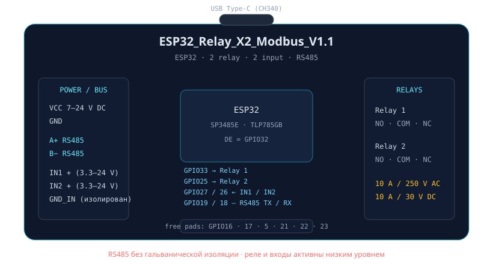

# ESP32_Relay_X2_Modbus_V1.1 — 2 реле, 2 входа, RS485



**Коротко:** `vuesp.relay-x2-modbus1-1` — прошивка Vuesp **5.0.12** для платы **LC Technology ESP32_Relay_X2_Modbus_V1.1** на ESP32. Два реле, два оптоизолированных входа, RS485 и локальный веб-интерфейс. Modbus RTU slave и master, профиль внешних устройств и live-переменные для dashboard.

## Что это за устройство

Плата автоматизации от Shenzhen LC Technology:

- ESP32 классический (не S3), 4 МБ flash;
- 2 реле с клеммами NO/COM/NC;
- 2 оптоизолированных входа (TLP785GB + 4.7 кОм), общий `GND_IN` не связан с землёй платы;
- RS485 на SP3485E;
- питание 7–24 В DC на клеммах **или** 5 В по Type-C;
- CH340 и Type-C для прошивки;
- съёмные клеммники и колодка свободных GPIO.

Это младшая версия платы `ESP32_Relay_X4_Modbus_V1.3` (4 реле / 4 входа). Официальной документации на X2 v1.1 нет: страница LC Technology содержит только фотографии. Распиновка ниже собрана по карточке устройства в ESPHome (PR #1921) и требует проверки мультиметром на конкретном экземпляре.

## Характеристики

| Параметр | Значение |
| --- | --- |
| Микроконтроллер | ESP32 (Xtensa LX6, 240 МГц), 4 МБ flash |
| Реле | 2, NO/COM/NC, ~10 A / 250 V AC, 10 A / 30 V DC |
| Входы | 2, оптоизоляция TLP785GB, 4.7 кОм, до ~24 В |
| RS485 | SP3485E, **без гальванической изоляции** |
| Питание | 7–24 В DC или 5 В Type-C |
| Прошивка | CH340 + Type-C (UART) |
| Wi-Fi | 802.11 b/g/n, 2.4 ГГц |
| Среда | PlatformIO + Arduino |

## Распиновка

| GPIO | Функция | Примечание |
| --- | --- | --- |
| 33 | Реле 1 | активный низкий |
| 25 | Реле 2 | активный низкий |
| 27 | Вход 1 | активный низкий, помечен автором ESPHome как TBC |
| 26 | Вход 2 | активный низкий, помечен автором ESPHome как TBC |
| 19 | RS485 TX | UART1 |
| 18 | RS485 RX | UART1 |
| 32 | RS485 DE | направление передачи, помечен как TBC |
| 16 | Пад `RX2` | свободный, UART2 RX |
| 17 | Пад `TX2` | свободный, UART2 TX |
| 5 | Пад `G5` | strapping-пин, при старте должен быть высоким |
| 21 | Пад `G21` | свободный |
| 22 | Пад `G22` | свободный |
| 23 | Пад `G23` | свободный |

Свободные пады по умолчанию подняты в `INPUT_PULLUP` и доступны для настройки на странице **GPIO**. Реле и входы зафиксированы и на этой странице отключены от редактирования.

## Схема подключения

| Клемма | Назначение |
| --- | --- |
| `VCC` / `GND` | питание 7–24 В DC |
| `A+` / `B−` | RS485 |
| `IN1` / `IN2` | плюс входа 1/2, 3.3–24 В |
| `GND_IN` | общий минус входов, изолирован от земли платы |
| `Relay 1` | `NO` / `COM` / `NC` |
| `Relay 2` | `NO` / `COM` / `NC` |

> **Важно.** Реле и входы **активны низким уровнем**: `0` на GPIO включает реле, активный вход даёт `0`. В dashboard это уже учтено формулами, а `relay(n, 1)` и `input(n) == 1` работают в логике «включено / активно».

### Питание

- Type-C даёт 5 В и UART — удобно для отладки без силового питания.
- Силовое питание 7–24 В подаётся на `VCC`/`GND`.
- Не подавайте 24 В на Type-C.

## Как устроен проект

- `src/gpio/gpio.cpp` — фиксированный список портов платы: реле, входы, свободные пады;
- `src/device/device.cpp` — функции ScriptRunner `relay()` и `input()`;
- `src/modbus/` — Modbus RTU slave, master-опрос, профиль `/tmp/modbus.bin`, проверку точки и функции ScriptRunner;
- `src/main.cpp` — стандартный цикл Vuesp: GPIO, device, web, discovery, runner;
- `vue/json/dashboard.json` — плитки двух реле и двух входов.

## Dashboard

| Плитка | Что показывает |
| --- | --- |
| `relay.1` | реле 1, кнопка ON/OFF |
| `relay.2` | реле 2, кнопка ON/OFF |
| `input.1` | вход 1, ON при активном входе |
| `input.2` | вход 2, ON при активном входе |
| `G5`, `RX2`, `TX2`, `G21`, `G22`, `G23` | свободные пады, HIGH/LOW |

Реле пишутся в `ports.<gpio>.value` с инверсией: логическое `ON` → `value = 0`.

На плате пады подписаны как `G5` (GPIO5), `RX2` (GPIO16), `TX2` (GPIO17), `G21` (GPIO21), `G22` (GPIO22), `G23` (GPIO23). `RX2`/`TX2` — это выводы второго UART; в прошивке они используются как обычные GPIO.

Свободные пады по умолчанию подняты в `INPUT_PULLUP` с прерыванием `CHANGE`, поэтому плитка обновляется при замыкании пада на `GND`. Если на странице **GPIO** переключить пад в `OUTPUT`, `PWM` или `ADC`, плитка продолжит показывать его значение как `HIGH/LOW`; для точного числа используйте страницу **GPIO**.

## ScriptRunner

| Функция | Аргументы | Назначение |
| --- | --- | --- |
| `relay(n, state)` | `n = 1..2`, `state = 0/1` | включить (`1`) или выключить (`0`) реле |
| `input(n)` | `n = 1..2` | `1`, если вход активен, иначе `0` |
| `var(id)` | id переменной профиля | текущее значение (`float`) или строка |
| `var(id, value)` | id и новое значение | обновить переменную и записать её точку, если она writable |
| `modbus(device, point)` | id или адрес устройства; id или адрес точки | значение точки из профиля |
| `modbus(device, point, value)` | id/адрес устройства, id/адрес точки, значение | поставить запись в очередь master |
| `fade(gpio, value, time)` | gpio, целевое значение, время | плавно изменить выход |
| `http(method, url, ...)` | — | заготовка HTTP-запроса, возвращает `200` |

Подсказки для редактора скриптов: устройство-специфичные `var`, `modbus`, `relay`, `input` и событие `modbus` лежат в `vue/json/suggestions.json`; общие `fade` и `http` — в `vuesp-components`.

Событие `modbus` возникает при изменении любой live-переменной. Пример: вывести значение переменной `coils`.

Пример: реле 1 повторяет вход 1.

```text
if:input(1);relay(1, 1);else;relay(1, 0);end;
```

Обратная связь: реле 2 включается по фронту входа 2 (простая защёлка на переменной).

```text
$u0=input(2);
if:$u0;relay(2, 1);else;relay(2, 0);end;
```

Обработчик изменения Modbus-переменной:

```text
on('modbus');
  $f0=var('coils');
  $display=$f0;
end;
```

## Modbus RTU (slave и master)

RS485: `TX = GPIO19`, `RX = GPIO18`, `DE = GPIO32`. Один UART и один DE, поэтому **slave и master взаимоисключающие**: режим выбирается на странице **`/device/modbus/`**.

Параметры по умолчанию: режим **slave**, адрес `1`, `9600 8N1`. Если сохранённого конфига нет (например, после `uploadfs`), плата стартует сразу в slave. В web UI можно выбрать `4800`, `9600` или `19200` и чётность `None/Even/Odd`; стоп-биты `1/2`. Общий блок RS485 показывается для Slave и Master, в режиме `Off` поля видны, но отключены.

Настройки связи хранятся в `ConfigStore` (`/tmp/config.bin`, ключ `modbus`) и переживают обычную перезагрузку и `upload` прошивки. Профиль master хранится отдельно, в `/tmp/modbus.bin`.

> При обновлении LittleFS через `uploadfs` стираются и `/tmp/config.bin`, и `/tmp/modbus.bin`. После такого обновления настройки и профиль нужно задать заново; обычная прошивка `upload` их не трогает. Для переноса профиля используйте экспорт/импорт `.bin` на странице Modbus.

### Карта (slave)

| Тип | Адрес | Значение |
| --- | --- | --- |
| Coil | `0–1` | реле 1–2 |
| Coil | `2–7` | свободные пады, если настроены как output |
| Discrete input | `0–1` | входы 1–2 |
| Discrete input | `2–7` | свободные пады |
| Holding / Input register | `0` | маска реле (биты 0–1) |
| Holding / Input register | `1` | маска входов (биты 0–1) |
| Holding / Input register | `2` | маска падов (биты 0–5) |
| Holding / Input register | `3–5` | версия прошивки major/minor/patch |
| Holding / Input register | `6–7` | uptime, младшее/старшее слово |
| Holding / Input register | `8` | Modbus-адрес |
| Holding / Input register | `9` | индекс скорости: 0 — 4800, 1 — 9600, 2 — 19200 |
| Holding / Input register | `10` | роль: 0 — off, 1 — slave |
| Holding / Input register | `11` | последняя ошибка |
| Holding / Input register | `12` | requests, младшее слово |
| Holding / Input register | `13` | errors, младшее слово |

Функции: `01`, `02`, `03`, `04`, `05`, `06`, `0F`, `10`. Фиксированные holding `0–13` только читаются; динамические slave-строки `100–131` могут быть `Writable` и принимают запись по `06`/`10`. Broadcast-адрес `0`: запись применяется, ответа нет. Неверный CRC, адрес или функция дают стандартное исключение.

Реле и входы активны низким уровнем: coil `1` включает реле (в порт пишется `0`), активный вход отдаётся как `1` (в порту `0`).

### Примеры кадров (адрес 1)

```text
# прочитать два реле
01 01 00 00 00 02 BD CB

# прочитать два входа
01 02 00 00 00 02 F9 CB

# прочитать два holding-регистра
01 03 00 00 00 02 C4 0B

# включить реле 1
01 05 00 00 FF 00 8C 3A

# выключить реле 1
01 05 00 00 00 00 CD CA
```

Карта реле и входов совпадает с заводской картой LC Technology; отличие — адрес по умолчанию: у LC `255`, у Vuesp `1`.

### Master: профиль и опрос

Master опрашивает внешние RTU-устройства по декларативному профилю. На странице Modbus можно добавлять, изменять и удалять устройства, точки и переменные, применять профиль и сохранять его в `/tmp/modbus.bin`. Там же есть экспорт и импорт `.bin`.
Устройства, точки и переменные добавляются и редактируются в диалоговых окнах: `Enter` сохраняет форму, `Esc` закрывает без изменений. Удаление подтверждается отдельным диалогом. Кнопки Apply/Save показывают реальное состояние: отправка, подтверждение от платы, ошибка или таймаут. Ошибки полей показываются под соответствующим полем.

Лимиты: **8 устройств, 64 точки, 32 переменные**.

Устройство:

| Поле | Смысл |
| --- | --- |
| `id`, `name` | идентификатор для скриптов и подпись |
| `address` | Modbus-адрес `1..247` |
| `interval` | период опроса, мс, не меньше `100` |
| `timeout` | таймаут ответа, мс, не меньше `50` |
| `retries` | число повторов `0..5` |
| `enabled` | участвует ли устройство в опросе |

Точка:

| Поле | Смысл |
| --- | --- |
| `device` | индекс устройства |
| `fc` | `01/02/03/04` |
| `address` | адрес регистра или бита |
| `type` | `U16`, `S16`, `U32`, `S32`, `U64`, `S64`, `Float32`, `Float64`, `Bool`, `String`, `Bit`, `Enum`, `BCD` |
| `registers` | число регистров для `String` (`1..16`); для остальных вычисляется по типу |
| `flags` | `Writable` (бит 4), `Bytes LE` (бит 2), `Words LE` (бит 1) |
| `decimals`, `scale`, `offset`, `unit` | форматирование значения |
| `var` | индекс переменной или `—` |

Переменная:

| Поле | Смысл |
| --- | --- |
| `id`, `name` | ключ для dashboard и ScriptRunner |
| `type` | тип отображения |
| `point` | индекс точки-источника |
| `source` | путь к значению (`ports.5.value`, `dallas.<rom>.temp`, `vars.<id>.value`) |
| `decimals`, `unit` | форматирование |

Опрос идёт по кругу: для каждой точки master собирает запрос своей функцией, ждёт ответ, проверяет CRC и адрес, декодирует значение с учётом `scale/offset` и порядка байт/слов, обновляет `vars` и счётчики. Ошибка чтения помечает переменную как `Error`; при следующем успешном ответе качество снова `OK`. Повторы задаются устройством.

Live-значения отдаются в кадре `KEY_MODBUS`, профиль — в `KEY_MODBUSPROFILE`.

### Slave: динамические значения

Кроме фиксированной карты можно отдать наружу произвольные значения. Новых структур протокола нет: slave-строка — это `ModbusPoint` с `device = 0xFF`, а источник хранится в `ModbusVar.source[32]` строкой пути.

- `device = 0xFF` — slave-строка: отдаёт переменную по адресу `100…131`;
- `source` — путь к значению в дереве данных устройства;
- переменная без `source` и без точки задаётся скриптом: `var('id', value)`.

Для slave-строки `fc` = `03`/`04`, `type` — `U16/S16/U32/S32/Float32`, `address` — `100…131`, `var` — переменная. Флаг `Writable` разрешает запись из внешнего master (FC `06`/`10`); запись уходит в `source`, если он доступен для записи.

Поддерживаемые пути:

| Путь | Пример | Запись |
| --- | --- | --- |
| `ports.<gpio>.<field>` | `ports.5.value` | только `.value` |
| `device.<field>` | `device.analog` | нет |
| `info.<field>` | `info.freeHeap` | нет |
| `modbus.<field>` | `modbus.lastError` | нет |
| `dallas.<rom>.<field>` | `dallas.28ff64e1e01603c8.temp` | нет |
| `vars.<id>.value` | `vars.temp1.value` | нет |

`<field>` порта — любое скалярное поле (`value`, `mode`, `count`, `pressStart` и т. д.); для Dallas — `temp` или `valid`. Массивы, объекты и строки источником быть не могут. Неизвестный путь или отсутствующая Dallas дают качество `DISABLED`/`STALE` и значение `0`; профиль из-за этого не отклоняется.

Значение можно задать и скриптом: `var('temp1', 23.5)` — переменная сразу доступна slave-строке.

Пример: `ports.5.value` → переменная `pad5` → slave holding `100`; другой master читает `100`.

UI разделён по ролям: в режиме **Slave** показываются Profile, Register map и Slave values; устройства и master-точки скрыты. В режиме **Master** показываются устройства, master-точки и Variables.

На странице Modbus блок **Slave values** показывает занятость банка. Добавление и редактирование значения используют одно окно: источник — **данные устройства** или **скрипт**. В дереве доступны `ports`, `device`, `dallas`, `info`, `modbus`; «+» показывается только у скалярных полей. Тип, decimals и unit подставляются автоматически, ID, scale и offset находятся в **Advanced**, `Writable` показывается всегда.

**Register map** строится динамически: после фиксированных строк показываются все настроенные slave-значения из draft-профиля с адресами и типами. Клик по строке открывает детали: тип, число регистров, hex-регистры текущего значения, готовый read-кадр с CRC и пример ответа. Кадр копируется одной hex-строкой; неприменённые значения видны в деталях с пометкой `not applied`.

### Запись

Точки с флагом `Writable` можно записывать прямо из таблицы точек на странице Modbus или командой `CMD_WRITE` (`point`, `value`, `text`). Для coils используется `05`, для holding — `06` для одного регистра и `10` для нескольких. Строки пишутся посимвольно в регистры. Результат постановки в очередь возвращается в поле `ok`: `1` — запись принята, `0` — точка не writable или не найдена.

Запись из скрипта:

```text
$u0=modbus('sim', 'u32', 42);
$u0=modbus(1, 0, 42);          // device address 1, point address 0
```

Если точка не writable или адрес неверный, функция вернёт `0`. Числовой `device` — Modbus-адрес устройства, числовой `point` — поле `address` точки; если адреса повторяются, используйте id.

### Проверка точки

Проверка встроена в диалог **Add point / Edit point**, отдельной карточки Frame test больше нет. Блок **Test** собирает кадр из текущих полей точки:

- slave-адрес берётся у выбранного устройства;
- функция — из `FC`;
- адрес — из поля `Address`;
- количество — из типа: `U16/S16/Bool/Bit/Enum/BCD` — 1 регистр, `U32/S32/Float32` — 2, `U64/S64/Float64` — 4, `String` — поле `Registers`.

При включённом **CRC automatically** кадр только читается и пересобирается при каждом изменении полей. Если снять галочку, кадр становится редактируемым: изменения в hex обновляют `FC`, адрес, количество и выбранное устройство; изменения полей снова пересобирают кадр. Ручной CRC сохраняется и отправляется как есть.

Ответ показывается в hex, со статусом, временем и исключением. Дополнительно значение декодируется по выбранному типу с учётом `Bytes LE / Words LE`, `scale`, `offset`, `decimals` и `unit`; для `FC 01/02` — `ON/OFF`.

Пока тест держит шину, опрос master приостанавливается; после ответа или таймаута опрос продолжается. Статусы: `OK`, `Timeout`, `CRC error`, `Exception`, `Available in Master mode only`, `Invalid frame`, `Bus busy`.

### Формат `/tmp/modbus.bin`

Бинарный файл без JSON:

```text
header (16 байт): magic "VDMP", version, headerSize, payloadSize, crc32
payload (5504 байта): ModbusProfile
```

`ModbusProfile` содержит `key`, `command`, `version`, счётчики и фиксированные массивы: `ModbusDevice[8]`, `ModbusPoint[64]`, `ModbusVar[32]`. Запись атомарная: временный `/tmp/modbus.tmp`, затем rename. При старте проверяются magic, версия, размер и CRC32; при ошибке профиль пустой.

### Переменные в dashboard

Путь для плитки: **`vars.<id>.value`**, где `<id>` — `id` переменной профиля. Дополнительно в store есть `vars.<id>.text`, `unit`, `decimals`, `quality`, `updated`. Страница dashboard запрашивает профиль, поэтому имена переменных доступны сразу.

### Ограничения master

- Только функции `01/02/03/04` для чтения.
- Один общий таймаут на устройство; арбитраж между устройствами — последовательный.
- Больше 16 регистров в одной точке не читается/не пишется.
- Modbus TCP gateway не реализован; он появится вместе с Ethernet-устройством.

## Сборка и прошивка

```bash
cd vue
npm ci
npm run build-web

cd ..
~/.platformio/penv/bin/pio run
~/.platformio/penv/bin/pio run -t buildfs
```

Полная сборка (скрипты + web + прошивка):

```bash
cd vue
npm run build
```

`littlefs.bin` собирается из `data/`, а `data/www` очищается Vite при каждом `build-web`, поэтому в образ попадает только текущий хешированный бандл. При заливке web по файлам через `/fs` старые `assets/*` на устройстве не удаляются — их нужно удалять вручную; `littlefs.bin` заменяет FS целиком.

## Ограничения

- **RS485 не изолирован.** В промышленной среде нужен внешний изолятор, TVS и нормальное заземление.
- **Пины 27/26/32 не подтверждены производителем.** Автор карточки ESPHome помечает их как TBC — проверьте на своей плате.
- **`GPIO5` — strapping-пин.** При старте он должен быть высоким; не подтягивайте его к земле.
- **Реле 10 A — паспортный ток для резистивной нагрузки.** Для моторов, насосов и LED-драйверов нужен запас и снаббер.
- **Заводская прошивка LC теряется при перепрошивке.** Перед первой заливкой снимите дамп: `esptool.py read_flash 0 0x400000 backup.bin`.
- **Slave holding-регистры только для чтения.** Запись в slave — через coils; master умеет писать в чужие holding/coils.

## Источники

- ESPHome, карточка устройства (PR #1921, ещё не смержен): <https://github.com/esphome/devices.esphome.io/pull/1921>
- Исходник карточки и конфига: <https://github.com/mcurry-va/esphome-devices/blob/main/src/docs/devices/ESP32_Relay_X2_Modbus_v1.1/index.md>
- Родственная плата `ESP32_Relay_X4_Modbus_V1.3`: <https://devices.esphome.io/devices/esp32_relay_x4_modbus_v13/>
- LC Technology, страница продукта: <http://www.chinalctech.com/m/view.php?aid=979>
- Non-ESP32 аналог с подробным Modbus-мануалом: <https://bifelectronic.com/en/lc-technology-modules/22800-LC-Modbus-2R-D7.html>
