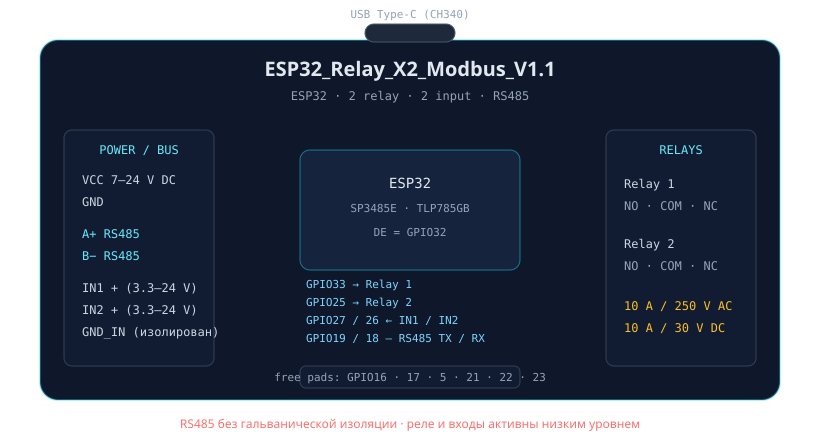

# vuesp.relay-x2-modbus1-1

Прошивка Vuesp для платы **LC Technology ESP32_Relay_X2_Modbus_V1.1**: два реле, два оптоизолированных входа и RS485 на ESP32.



Проект собран на базе шаблона [Vuesp](https://github.com/bondrogeen/vuesp): прошивка PlatformIO **5.0.12** + web UI **0.2.0** на Vue 3 и `vuesp-components@5.2.1`.

## Документация

Подробное описание платы, распиновка, схема подключения, карта Modbus-регистров, ScriptRunner и ограничения — в [DOCS.md](./DOCS.md).

## Особенности

- 2 реле: `GPIO33` и `GPIO25`, активный низкий уровень, NO/COM/NC.
- 2 оптоизолированных входа: `GPIO27` и `GPIO26`, активный низкий уровень, до ~24 В.
- Свободные пады: `G5`, `RX2`, `TX2`, `G21`, `G22`, `G23` (GPIO5/16/17/21/22/23).
- Локальный веб-интерфейс: dashboard с реле, входами и падами, GPIO, файлы, настройки, OTA.
- ScriptRunner: `relay()`, `input()`, `var()` и `modbus()`.
- RS485: `GPIO19` TX, `GPIO18` RX, `GPIO32` DE — Modbus RTU **slave и master**.

## Modbus

На странице `/device/modbus/` выбирается режим **Off / Slave / Master**. Настройки RS485 общие: скорость `4800/9600/19200`, чётность `None/Even/Odd`, стоп-биты `1/2`. Slave и master взаимоисключающие — на плате один UART и один DE.

- **Slave**: адрес `1` по умолчанию, функции `01/02/03/04/05/0F`, фиксированная карта регистров. Настройки хранятся в `ConfigStore` и переживают перезагрузку.
- **Master**: профиль до 8 устройств, 64 точек и 32 переменных; опрос по интервалам, таймауты и повторы; типы `U16/S16/U32/S32/U64/S64/Float32/Float64/Bool/String/Bit/Enum/BCD`; запись в writable-точки; проверка точки из диалога: кадр по полям точки, автоматический или ручной CRC, декодированный ответ.
- Профиль хранится бинарно в `/tmp/modbus.bin` (magic, версия, размер, CRC32) и переносится экспортом/импортом `.bin`.

Переменные master доступны в dashboard по пути `vars.<id>.value`. Подробности, карта регистров и формат профиля — в [DOCS.md](./DOCS.md#modbus-rtu-slave-и-master).

## Плата и окружение

- PlatformIO env: `esp32` (`esp32dev`, `espressif32@7.0.1`).
- Прошивка ESP32-only: ветки ESP8266/ESP32-C3 из шаблона удалены.
- Прошивка: `platformio.ini`.
- Web UI: `vue/`, Vue 3.5 + Vite 6 + `vuesp-components@5.2.1`.
- Файловая система: LittleFS, веб-сборка попадает в `data/www`.

## Сборка

```bash
cd vue
npm ci
npm run build-web
```

Полная сборка (web + прошивка):

```bash
cd vue
npm run build
```

Либо отдельно:

```bash
~/.platformio/penv/bin/pio run
~/.platformio/penv/bin/pio run -t buildfs
```

## Возможности

- локальный веб-интерфейс без облака;
- настройка Wi-Fi, безопасности, GPIO и файловой системы;
- dashboard с плитками реле, входов и переменных Modbus master;
- сценарии и автоматизация;
- обновление прошивки и файловой системы через веб-интерфейс.

## CI

GitHub Actions собирает web UI, прошивку и LittleFS для `esp32`, запускает тесты ScriptRunner и публикует артефакты в релиз при пуше тега.

## Репозиторий

<https://github.com/bondrogeen/vuesp.relay-x2-modbus1-1>

## Источники

- ESPHome, карточка устройства (PR #1921): <https://github.com/esphome/devices.esphome.io/pull/1921>
- Родственная плата `ESP32_Relay_X4_Modbus_V1.3`: <https://devices.esphome.io/devices/esp32_relay_x4_modbus_v13/>
- LC Technology, страница продукта: <http://www.chinalctech.com/m/view.php?aid=979>
